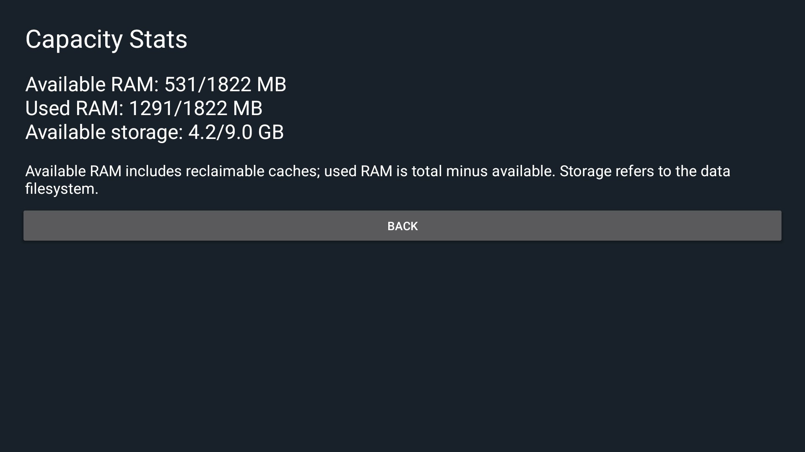

# Notification Center

A Google TV–style Notification Center side panel for CleanYourTV. Caches active notifications on
the TV without network access or background battery drain, and opens directly from the Quick Settings
panel or via intent.



## Features

- **Google TV design**: Translucent right-side panel matching the launcher's quick settings (290dp,
  Outfit typography, rounded cards).
- **D-pad remote friendly**:
  - `OK` on a card opens the posting application.
  - Hold `OK` (long press) dismisses that individual notification.
  - `Clear all` button empties the list.
  - `Back` or clicking the dim scrim exits the panel.
- **Lightweight & Safe**:
  - Extracts only essential fields (`key`, `package`, `title`, `text`, `postTime`, `contentIntent`).
  - Never retains `StatusBarNotification`, `Notification`, `RemoteViews`, or bitmaps (safe on 1 GB RAM TVs).
  - Capped at 20 notifications max, ordered newest first.
  - Automatically filters out ongoing background service / media spam (`FLAG_ONGOING_EVENT`) and group summaries.
- **Privacy first**:
  - Notification content stays 100% local on the TV.
  - Zero network permissions, zero analytics, zero logging of notification titles or body text.

## Permissions

None.

Notification Center declares no `<uses-permission>` tags in its manifest. The notification listener
service is protected by `android.permission.BIND_NOTIFICATION_LISTENER_SERVICE`, which can only be bound
by the Android system and is enabled explicitly by the user or through ADB.

## Install

From the repository root:

```bash
TV_HOST=<tv ip> addons/notification-center/install.sh
```

Or build and sideload manually:

```bash
cd addons/notification-center && ./gradlew assembleRelease
TV_HOST=<tv ip> tools/venv/bin/python -I tools/tv.py --push app/build/outputs/apk/release/app-release.apk /data/local/tmp/tvnotifications.apk
TV_HOST=<tv ip> tools/venv/bin/python -I tools/tv.py "pm install -r /data/local/tmp/tvnotifications.apk; rm -f /data/local/tmp/tvnotifications.apk"
TV_HOST=<tv ip> tools/venv/bin/python -I tools/tv.py "cmd notification allow_listener io.github.emmanuel11003.tvnotifications/.Notifications"
```

## Testing on TV

Post a test notification from your computer over ADB:

```bash
TV_HOST=<tv ip> tools/venv/bin/python -I tools/tv.py 'cmd notification post -t "Test Title" tag1 "Hello from CleanYourTV"'
```

Then open Quick Settings and click the Notifications tile to view the panel.

## Uninstall

```bash
TV_HOST=<tv ip> addons/notification-center/install.sh --uninstall
```

Or manually:

```bash
TV_HOST=<tv ip> tools/venv/bin/python -I tools/tv.py "cmd notification disallow_listener io.github.emmanuel11003.tvnotifications/.Notifications; pm uninstall io.github.emmanuel11003.tvnotifications"
```
